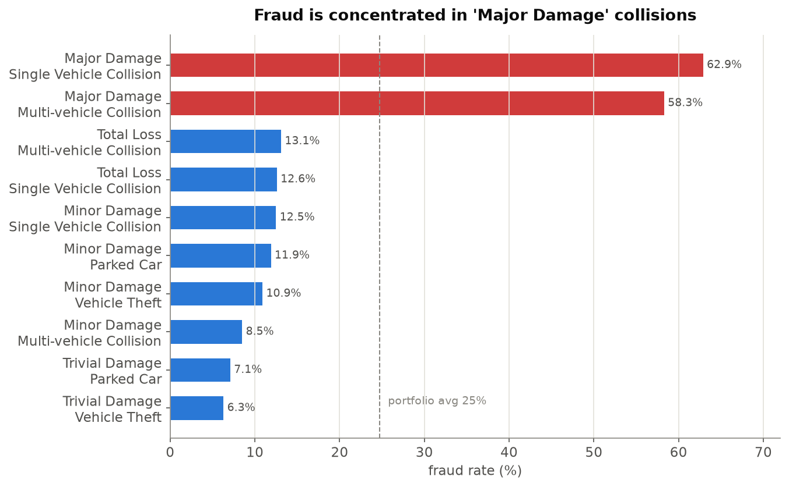
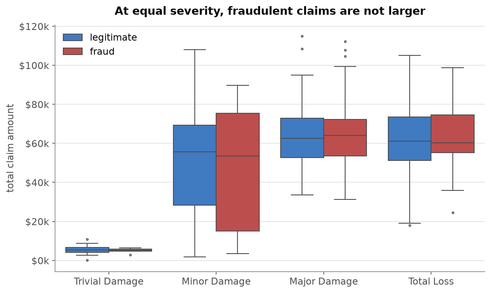
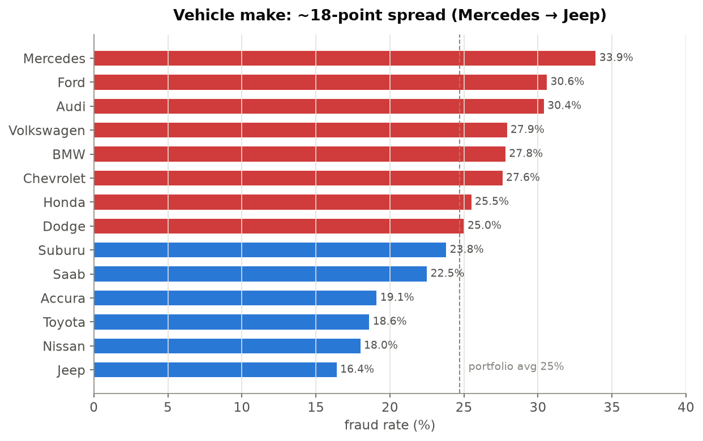
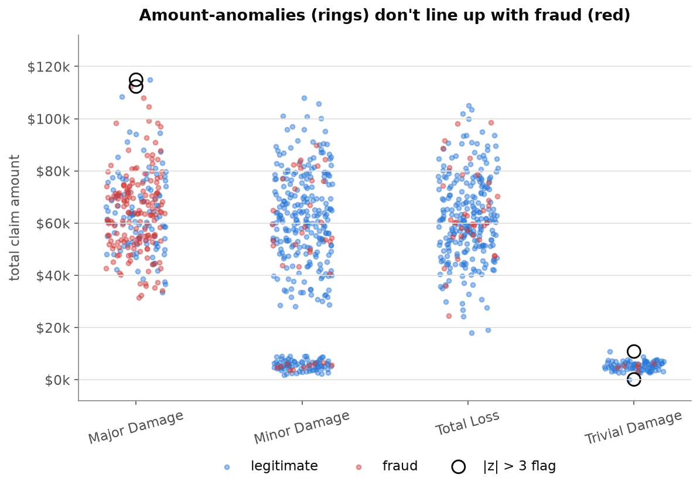

# Insurance Claims Analytics — SQL + Python

Normalizing a real-world auto-insurance dataset into a relational schema, then using
**SQL (window functions, CTEs, subqueries)** and **Python (pandas, matplotlib/seaborn)**
to find where claims fraud actually concentrates — and, just as importantly, where the
"obvious" red flags turn out to be dead ends.

The dataset ships with a ground-truth `fraud_reported` label, so every claim in this
analysis can be checked against reality.

---

## Problem statement

Insurance carriers lose a large share of claims spend to fraud, but investigator capacity
is limited. The analytical question is a triage question: **given a new claim, which
attributes tell us it is worth a closer look?** This project works through incident
characteristics, claim economics, customer demographics, geography, seasonality, and
vehicle type to see which of them carry a real fraud signal on this book of business.

## Dataset

- **Source:** [Auto Insurance Claims Data](https://www.kaggle.com/datasets/buntyshah/auto-insurance-claims-data) (Kaggle, uploaded by Bunty Shah)
- **Shape:** 1,000 claims × 39 columns, one flat table; incidents span Jan–Mar 2015
- **Label:** `fraud_reported` (Y/N) — 24.7% of claims are fraudulent (this is a curated
  teaching dataset, so the base rate is far above a real portfolio's ~1–2%; treat the
  numbers below as *relative* comparisons)
- **Normalization:** the flat CSV was cleaned (`"?"` placeholders → NULL, a negative
  `umbrella_limit` → NULL, junk trailing column dropped) and split into **4 related tables**.

### Schema

```
policies                         vehicles
--------                         --------
policy_number  (PK) ────────1:1──< policy_number (FK)
months_as_customer, age            auto_make, auto_model, auto_year
policy_bind_date, policy_state
policy_csl, policy_deductable        incidents
policy_annual_premium, umbrella…     ---------
insured_sex/education/occupation ─1:1─< policy_number (FK)
insured_hobbies/relationship          incident_date, incident_type
capital_gains, capital_loss           collision_type, incident_severity
                                      authorities_contacted, incident_city/state
claims                                incident_hour_of_the_day, witnesses
------                                number_of_vehicles_involved
claim_id (PK)                         property_damage, police_report_available
policy_number (FK) ──────────┐        bodily_injuries
incident_id   (FK) ─1:1──────┴──────< incident_id (PK)
total_claim_amount
injury_claim / property_claim / vehicle_claim
fraud_reported
```

| Table | Rows | Grain |
|---|---|---|
| `policies` | 1,000 | one insured party + policy terms |
| `vehicles` | 1,000 | one insured vehicle |
| `incidents` | 1,000 | one reported event |
| `claims` | 1,000 | one claim + fraud label |

Relationships are 1:1 in this dataset but modeled as 1:many to mirror a real carrier's system.
Full DDL: [`db/schema.sql`](db/schema.sql).

---

## Sample queries

All 10 queries are in [`queries/analysis_queries.sql`](queries/analysis_queries.sql), each
commented with the business question it answers. Run them all with
`python queries/run_queries.py`.

**Q1 — Fraud rate by incident severity × type** (`DENSE_RANK` window, conditional aggregation)

```
incident_severity   incident_type              claims  fraud_rate_pct  rank
Major Damage         Single Vehicle Collision      132           62.9     1
Major Damage         Multi-vehicle Collision       144           58.3     2
Total Loss           Multi-vehicle Collision       145           13.1     3
Minor Damage         Single Vehicle Collision      136           12.5     5
Trivial Damage       Vehicle Theft                  48            6.3    10
```

**Q4 — Do fraudulent claims cost more? (fraud vs legit, same severity)** (conditional aggregation)

```
incident_severity   claims  avg_amount_fraud  avg_amount_legit  gap
Total Loss             280           64,041           61,792   +2,249
Major Damage           276           64,116           63,993     +123
Minor Damage           354           48,726           48,633      +93
Trivial Damage          90            5,038            5,320     −282
```

**Q5 — Is fraud concentrated in the most expensive claims?** (`NTILE(10)` + running share)

```
amount_decile  amount_range        claims  fraud_rate_pct  pct_of_all_fraud_from_here_up
          10   $81,400–$114,920       100           28.0           11.3
           8   $68,040–$74,360        100           37.0           37.7
           5   $53,280–$57,970        100           30.0           71.7
           2   $5,760–$32,800         100            8.0           95.5
           1   $100–$5,720            100           11.0          100.0
```

**Q10 — Running cumulative claim cost** (`SUM() OVER (ORDER BY …)` + ratio to grand total)

```
incident_date  day_claim_amount  running_total   pct_of_period_total
2015-01-01            867,820        867,820             1.6
2015-02-01            996,520     28,757,490            54.5
2015-03-01            674,720     52,761,940           100.0
```

---

## Key insights

Full write-up with recommended actions and caveats: [`ANALYSIS.md`](ANALYSIS.md).

1. **Incident severity is almost the entire fraud signal.** "Major Damage" collisions run
   **58–63% fraud** vs 6–13% for every other severity/type combination. 28% of claims
   (the Major Damage pool) contain **68% of all fraud**. A single "route all Major Damage
   to SIU" rule gets 61% precision / 68% recall.
2. **Fraud is not inflated in dollars.** Holding severity fixed, fraudulent and honest
   claims average within **~$120** of each other. The fraud is in fabricating/exaggerating
   the *incident*, not padding the invoice — so detection belongs at incident validation,
   not claim-amount review.
3. **Screening by claim size barely helps.** Fraud rate is flat (~27–37%) across the top
   8 cost deciles; only the cheapest 20% of claims are low-risk.
4. **Vehicle make has a real ~18-point gradient** (Mercedes 33.9% → Jeep 16.4%), but it is
   almost certainly confounded with owner profile — usable as a model feature, not a rule.
5. **Honest negatives:** policy age, `policy_state`, age/education demographics, and month
   show **little or no usable signal** on this book. Worth stating in an interview: "I
   checked these and they weren't there."
6. **A textbook z-score anomaly detector fails here.** Flagging claims with `|z| > 3` on
   amount (per severity) catches **0.4% of fraud at ~base-rate precision** — a direct
   consequence of insight #2, and a demonstration of why unsupervised cost-outlier
   detection is the wrong tool for this problem.
7. **Two data-quality bugs found:** one incident dated before its policy's bind date; one
   negative `umbrella_limit`. Both isolated; ingestion validation recommended.

### Charts

Exported to [`charts/`](charts/) by the notebook:

| | |
|---|---|
|  |  |
|  |  |

---

## Tech stack

| Layer | Tools |
|---|---|
| Database | MySQL 8+ (tested on 9.2) |
| Data prep | Python, pandas, numpy |
| DB access | SQLAlchemy + `mysql-connector-python`, credentials via `python-dotenv` |
| Analysis | Jupyter, pandas, matplotlib, seaborn |
| Queries | 10 commented SQL queries — CTEs, `RANK`/`DENSE_RANK`, `NTILE`, `PERCENT_RANK`, `LAG`, `SUM() OVER`, correlated subqueries, conditional aggregation |

---

## How to run

**Prerequisites:** MySQL running locally, Python 3.11+.

```bash
# 1. Get the data
#    Download insurance_claims.csv from
#    https://www.kaggle.com/datasets/buntyshah/auto-insurance-claims-data
#    and place it at data/insurance_claims.csv

# 2. Python environment
python -m venv .venv && source .venv/bin/activate
pip install -r requirements.txt

# 3. Database + credentials
mysql -u root -e "CREATE DATABASE insurance_claims;
                  CREATE USER 'insurance_app'@'localhost' IDENTIFIED BY 'choose_a_password';
                  GRANT ALL PRIVILEGES ON insurance_claims.* TO 'insurance_app'@'localhost';"
cp .env.example .env          # then edit .env with your DB_PASSWORD

# 4. Clean, normalize, and load (applies db/schema.sql, verifies row counts + FKs)
python data/normalize_data.py
#   add --no-db to only write the normalized CSVs

# 5. Run the SQL analysis (prints every query's result as a table)
python queries/run_queries.py
#   or a subset:  python queries/run_queries.py 1 4 5

# 6. Charts + anomaly detection
jupyter notebook analysis/analysis.ipynb
```

---

## Repository layout

```
data/
  insurance_claims.csv      raw Kaggle dataset (tracked)
  normalize_data.py         clean + split into 4 tables + load MySQL
db/
  schema.sql                CREATE TABLE DDL
  connection.py             SQLAlchemy engine from .env
queries/
  analysis_queries.sql      the 10 analytical queries
  run_queries.py            execute + pretty-print each result
analysis/
  analysis.ipynb            pandas analysis, 7 charts, z-score anomaly pass
charts/                     exported PNGs
ANALYSIS.md                 business findings (F1–F8), analyst voice
EXPLANATION.md              build journal: decisions, difficulties, insights per step
```

---

## Attribution

Dataset: **"Auto Insurance Claims Data"** by **Bunty Shah** on Kaggle —
<https://www.kaggle.com/datasets/buntyshah/auto-insurance-claims-data>. Used here for
educational, non-commercial analysis.
